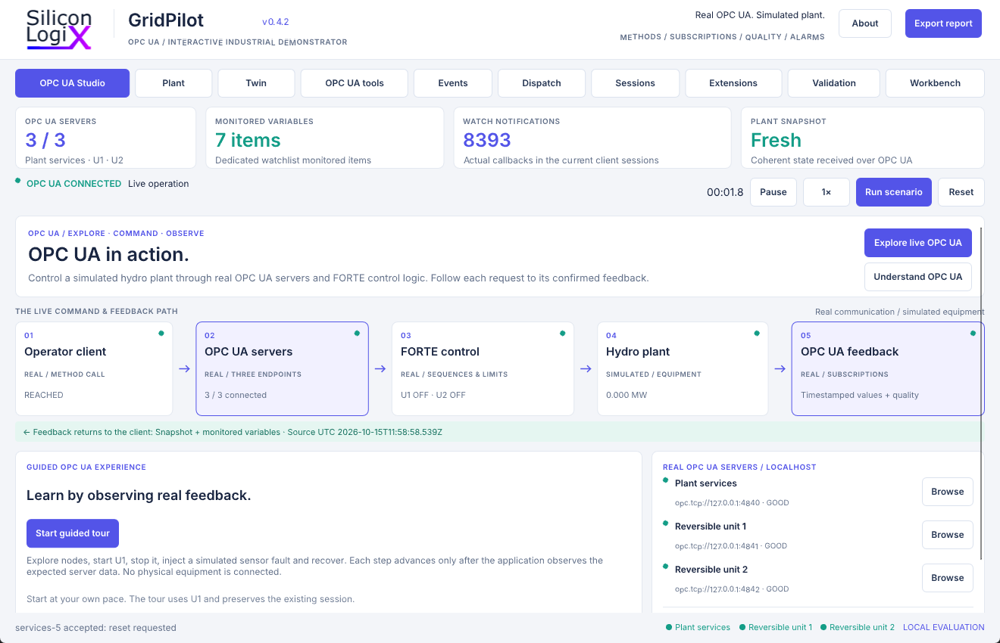

<!-- Copyright (c) 2026 Marco Pezzullo / Silicon LogiX. See LICENSE. -->
# SLX GridPilot

**Explore OPC UA by controlling a simulated hydro plant through real servers and FORTE control logic.** Browse live nodes, call methods, receive monitored values and investigate data quality and alarms. The two reversible units provide visible equipment responses to the protocol exchanges. Built with Rust, Slint, Bevy, open62541 and Eclipse 4diac FORTE.

[Download the Windows x64 portable application](https://github.com/Silicon-Logix/slx-gridpilot/releases/latest).

## Run on Windows

Extract **SLX-GridPilot-0.4.2-win64.zip** and double-click **SLX GridPilot.exe**. Keep the extracted folder together. Launching the portable application requires no downloads, compilation, Python, Rust, cloud service or physical hardware.

Closing the desktop shuts down the processes it started. Windows x64 and a Vulkan-capable graphics driver are required. The application creates local preferences, sessions, history and exports in `workspace/`.

Start in **OPC UA Studio**. Its live command/feedback map distinguishes real protocol and control processes from simulated equipment. **Start guided tour** walks through browsing U1, requesting power, confirming a stop, observing uncertain sensor quality, then acknowledging and recovering an alarm. Each step requires observed server feedback. Read [the OPC UA learning guide](docs/opcua-learning.md).

Select **Run scenario** for the complete generation, second-unit insertion, stop and pumping sequence. Use **Workbench** for sequence diagnostics, historical charts, test plans and replay.

## Capabilities

- OPC UA Studio with live endpoint/item/notification counters, command/feedback map, five-step feedback-verified tour and contextual explanations of NodeId, quality, timestamps, subscriptions, deadband, methods and alarms.
- Embedded 3D plant, cutaway and unit inspection; U1/U2 labels, component selection, smooth camera positioning, confirmed actuator motion, flow arrows and electrical activity.
- Three independent OPC UA devices with source timestamps, quality, engineering units, typed control methods and a coherent `Snapshot`.
- Address-space browser, search, quality filtering, persistent watchlists, dedicated monitored items, configurable intervals/deadband, revised subscription information, clipboard tools and NodeSet2 XML/JSON/CSV export.
- Standard OPC UA alarm conditions with severity, active/acknowledged state, comments and condition refresh through external clients. Acknowledgement preserves the physical fault and controller latch.
- FORTE startup, stop, reversal and fault sequences with feedback diagnostics; repeatable actuator, sensor, communication and electrical faults.
- Priority/balanced dispatch comparison, fixed 100 ms simulation steps, water/energy accounting and documented model assumptions.
- Continuous local numeric history, selectable sessions, multivariable charts with independent scales, commands/alarms timeline and CSV export.
- Full state recording, selectable recordings, pause, replay and seek through the OPC UA devices.
- Visual timed test plans with expected feedback, validation, local save/load, cancellation and actual passed/failed results.
- Local workspace preferences, adjustable side panels, keyboard shortcuts, product About, licenses, reports and diagnostic exports.

## OPC UA access

| Device | Endpoint |
|---|---|
| Plant services | `opc.tcp://127.0.0.1:4840` |
| Unit 1 | `opc.tcp://127.0.0.1:4841` |
| Unit 2 | `opc.tcp://127.0.0.1:4842` |

Resolve namespace URI `urn:siliconlogix:gridpilot:v1` and browse `Objects/Device`. Use `SetPower(Double)` and `Stop()` for typed control, or call `Request(String)` with a JSON command such as `{"action":"setpoint","mw":1.2}`. A receipt confirms queuing; `LastCommand` reports controller acceptance and the state/actuators confirm execution.

The endpoints bind to loopback with SecurityPolicy None and anonymous access. This is an evaluation demonstrator with a lumped hydraulic model. See [OPC UA](docs/opcua.md), [physical assumptions](docs/physical-model.md) and [verification scope](docs/validation.md).

## Public repository and implementation

The public repository contains operator documentation, selected screenshots, licensing information and publication checks. GridPilot's OPC UA integration, controller application, numerical engine, coordinator and desktop implementation are proprietary and are not included as readable application source.

Download the complete Windows package to run the demonstrator. The public repository does not build the proprietary application. The executable needs no compiler, package installation or launch script.

| Directory | Contents |
|---|---|
| `docs` | OPC UA learning guide, operating instructions, architecture and model limits |
| `assets/screenshots` | Selected captures of the delivered desktop application |
| `tools/audit-publication.py` | Public inventory, credential, metadata and attribution checks |

The Windows ZIP includes runtime models, configuration, dependency licenses, notices and corresponding third-party sources. SDK headers, application sources, raw test reports and user data are excluded from this repository. Releases contain the Windows ZIP and its SHA-256 checksum.

Read [the operator guide](docs/operator-interface.md), [quick start](docs/quick-start.md), [architecture](docs/architecture.md) and [contribution guide](CONTRIBUTING.md).

## Screenshots

Explore [OPC UA Studio](assets/screenshots/opcua-studio.png), the [3D plant](assets/screenshots/overview.png), [node details](assets/screenshots/ua-node-detail.png), [watchlists](assets/screenshots/ua-watchlist.png), [uncertain sensor quality](assets/screenshots/opcua-tour-quality.png), [historical trends](assets/screenshots/history-trends.png), [test plans](assets/screenshots/test-plan.png) and [product About](assets/screenshots/about.png).

## License

Copyright (c) 2026 Marco Pezzullo / Silicon LogiX. Original code and assets use the [Silicon LogiX Evaluation License 1.0](LICENSE). This license permits study and business evaluation; production integration and distribution of modifications require written permission. Third-party licenses remain independent. See [third-party notices](THIRD_PARTY_NOTICES.md).
