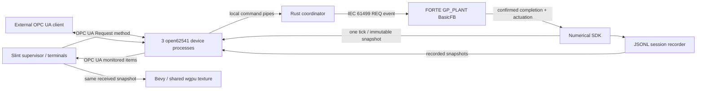

<!-- Copyright (c) 2026 Marco Pezzullo / Silicon LogiX. See LICENSE. -->
# Architecture

There is no direct physics pointer in the desktop and no UI-to-simulator command bypass. The desktop uses three independent open62541 client workers. The services subscription supplies the coherent plant snapshot to metrics, charts and the scene; the unit subscriptions supply connection diagnostics. Each worker owns its UA session, with a 500 ms request timeout. Namespace indices are discovered from the URI on each connection.

The coordinator owns the fixed-step clock and starts one FORTE process and three virtual-device processes. Each device runs its own UA event loop, stdout command pipe, stdin telemetry pipe and identifiable log. Native telemetry transport is a local implementation boundary; the public supervisor interface remains OPC UA. External clients can operate or read the exact same model.

The physical core integrates water transfer and actuator motion. It receives FORTE valve, gate and signed speed targets. It does not allocate demand or select state transitions. FORTE dispatch and sequences live exclusively in `GP_PLANT`, a `CBasicFB` executed by the FORTE resource's event-chain thread. The coordinator deploys it into `RES`, writes a fixed-step input frame, triggers `REQ` and waits for the monotonically increasing `Done` transaction before reading `Result`. Transactions stay unique across simulation resets, avoiding stale controller completion.

The UI and Bevy share a wgpu 24 device through the official Slint 1.12.1 Bevy adapter, adapted to reuse a stable manual render target and disable MSAA. Bevy loads the original glTF hierarchy and embedded materials without another axis conversion. Only its GPU thread owns mesh/render resources. Immutable received snapshots drive live transforms; presentation changes never modify process values.

The desktop holds a Windows process job with `KILL_ON_JOB_CLOSE` for the coordinator and its descendants. Normal exit first requests coordinated shutdown and allows bounded cleanup; the job prevents orphaned device processes after abnormal desktop termination. The coordinator refuses occupied endpoint ports instead of deploying into another controller.

The numerical SDK provides the physical integration engine and C ABI 1. The evaluation coordinator links the same numerical implementation. The Windows distribution provides the compiled application and runtime. The public repository contains operator documentation and selected screenshots. The Windows ZIP retains dependency licenses and corresponding third-party sources; application implementations and SDK headers are excluded from the repository.
