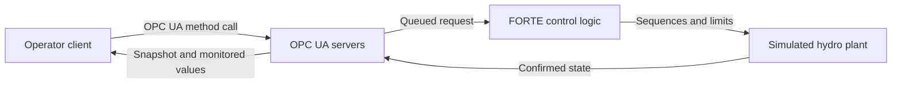

<!-- Copyright (c) 2026 Marco Pezzullo / Silicon LogiX. See LICENSE. -->
# Explore OPC UA with GridPilot

GridPilot commands and observes a simulated pumped-storage hydro plant through real local OPC UA servers. OPC UA sessions, method calls, subscriptions, status codes, timestamps and FORTE control processes run on the computer. Water, rotating machinery, electrical power and injected equipment faults are simulated. No physical PLC or plant is connected.

## Five-step tour

Open **OPC UA Studio**. The tour requires live, unpaused operation, both units healthy and safely OFF, and no running test or comparison. It keeps the current session. Use Plant / Stop / Recover, or Reset, if the initial state needs restoring.

1. Select **Start guided tour**, then **Browse U1**. The application opens the actual server address space. Select Power, State or SpeedSensor and inspect its NodeId, data type, quality and source timestamp. Return through **OPC UA Studio**. Successful live Browse / Read results unlock Next step.
2. Select **Request +1.2 MW**. Watch the Request stage and controller state. A queued receipt confirms delivery; controller acceptance and stable GENERATING feedback are checked separately. The tour waits for the request's matching acceptance and U1's actual power.
3. Select **Stop U1**. Completion requires OFF, zero rotor speed and closed inlet and distributor. **See U1 in 3D** shows the same feedback in the twin.
4. Select **Inject sensor fault**. This creates a simulated U1 sensor fault. Completion requires both an active controller alarm and non-Good quality on the real SpeedSensor node. **Inspect quality** opens the quality filter.
5. Select **Acknowledge alarm**, then **Clear & recover U1**. Acknowledgement records awareness while preserving the fault. Recovery clears the simulated cause, waits for safe rest and releases the latch. Complete the tour only after that feedback is confirmed.

Next step remains disabled until the expected state has been observed. A timer never completes a step. Missing/stale data cannot confirm a result. A reset or replay changes the session and ends the tour. Leaving the guide keeps the current plant state; the ordinary Stop / Recover controls remain available.

## What to inspect

**OPC UA tools / OPC UA concepts** explains NodeId, quality, timestamps, subscriptions, deadband, methods and alarms beside the live browser. Copy the selected connection recipe to use a separate OPC UA client. Resolve namespace URI `urn:siliconlogix:gridpilot:v1` instead of assuming a numeric namespace index.

The Studio counters show actual connected endpoints, configured watchlist monitored items and received watch callbacks. Watch subscriptions have their own sampling/publishing/deadband settings; Snapshot uses a separate subscription for coherent plant feedback. Counts describe the current client sessions and can reset after reconnecting. Source UTC is server time, while the simulation clock can pause or run faster.

Use **Open watchlist** to follow numeric changes and **Monitoring settings** to compare requested and server-revised intervals. The normal generation/pumping scenario remains available independently of the learning tour.

The evaluation endpoints are loopback-only and use anonymous access with SecurityPolicy None. Production certificates, user roles and physical-controller integration require additional engineering. See [the OPC UA contract](opcua.md) and [physical assumptions](physical-model.md).
